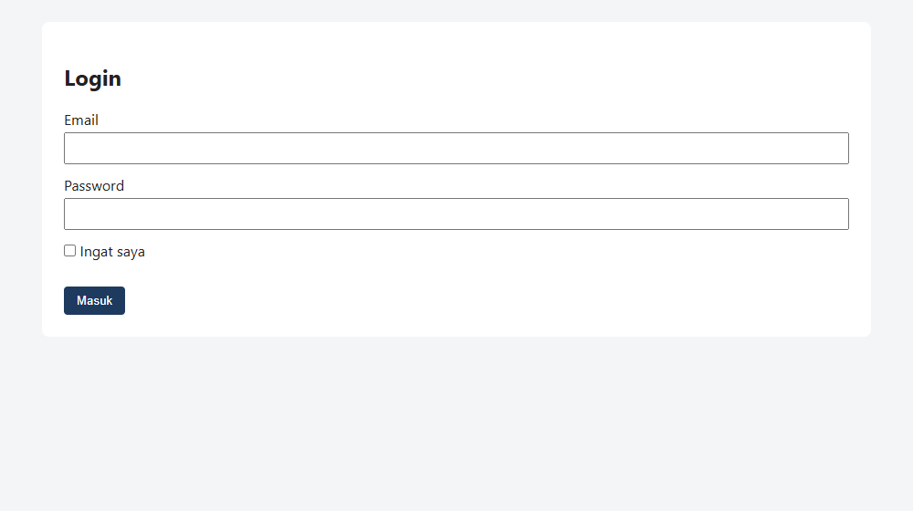
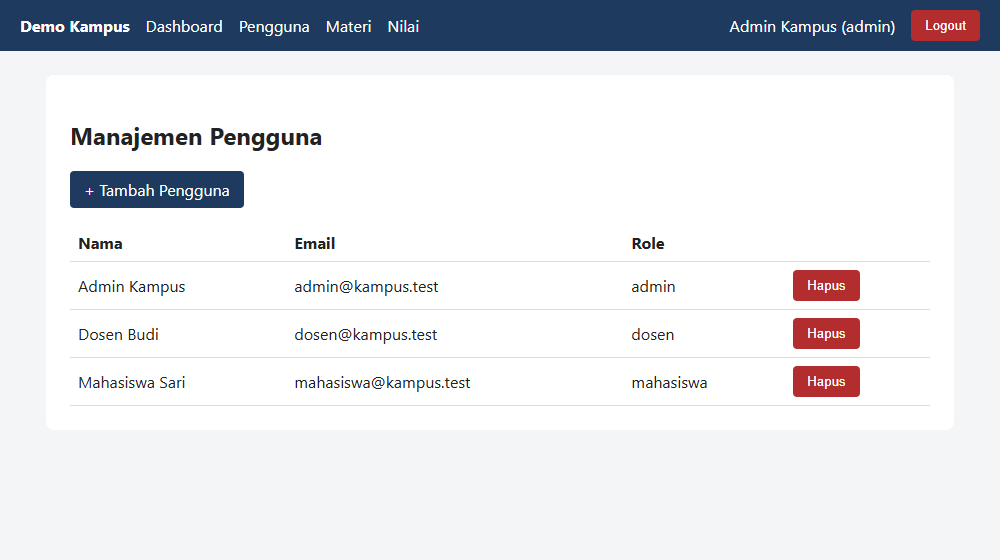
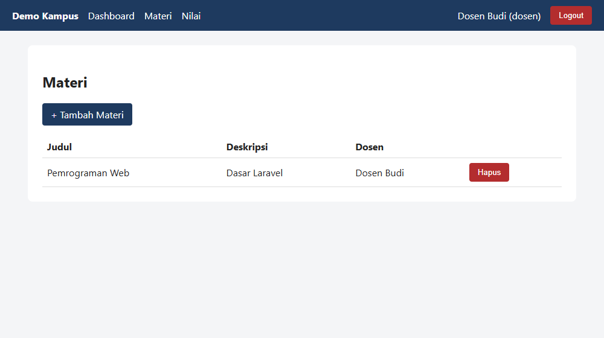
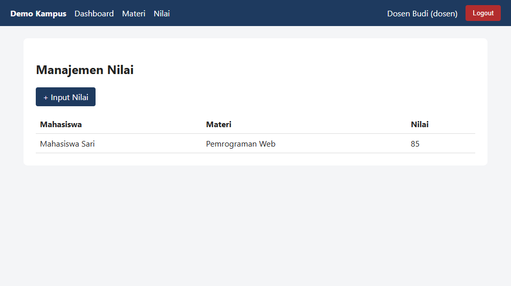
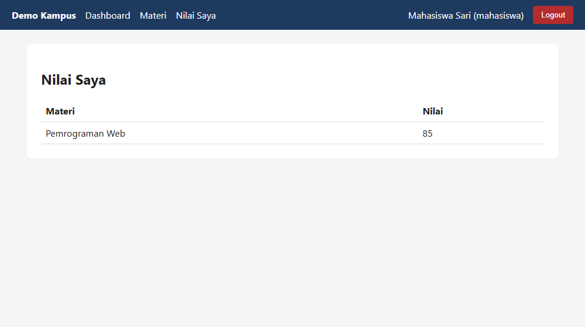
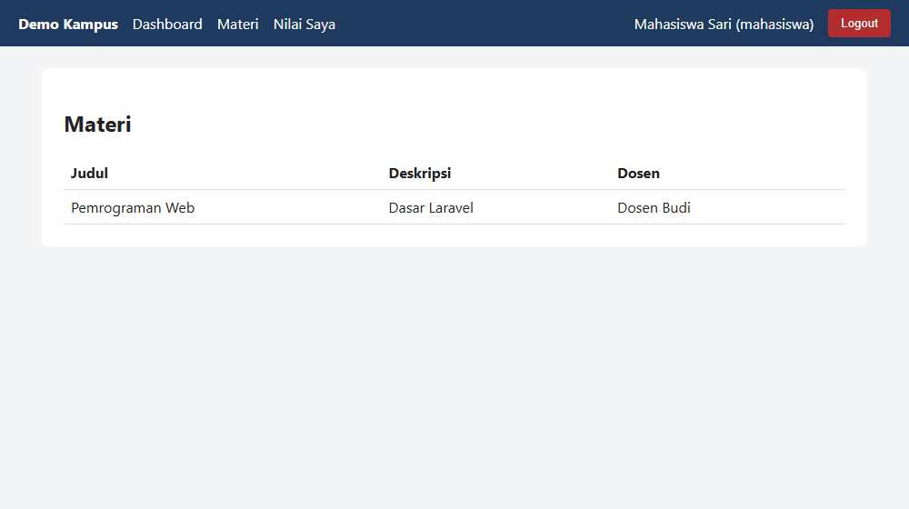
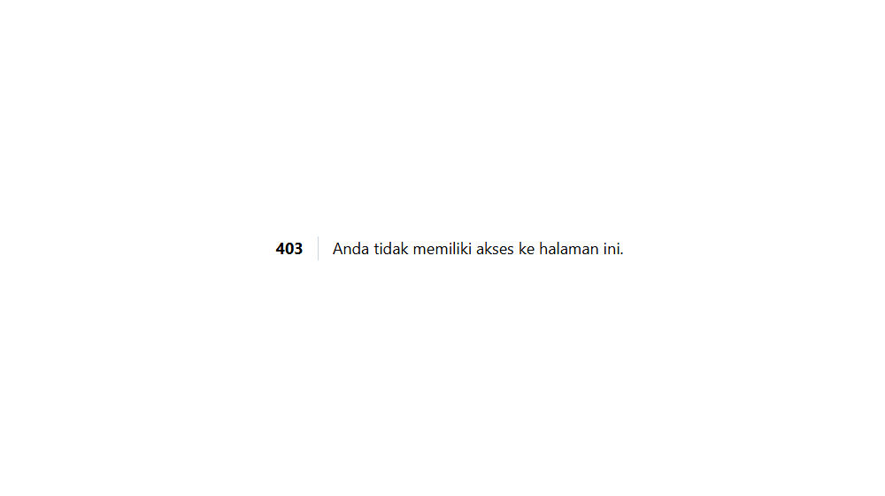

# Dokumentasi Pengujian Hak Akses (Admin, Dosen, Mahasiswa)

## Setup
```
php artisan migrate:fresh --seed
php artisan serve        # http://localhost:8000
php artisan test         # pengujian otomatis (tests/Feature/RoleAccessTest.php)
```

Akun uji (password semua: `password`):

| Role      | Email                 |
|-----------|-----------------------|
| admin     | admin@kampus.test     |
| dosen     | dosen@kampus.test     |
| mahasiswa | mahasiswa@kampus.test |

## Implementasi
- Kolom `role` di tabel `users` (migrasi `add_role_to_users_table`).
- Middleware `App\Http\Middleware\CheckRole`, alias `role` didaftarkan di `bootstrap/app.php`.
  Contoh: `->middleware('role:admin,dosen')`. Belum login → redirect `/login`; role tidak cocok → **403**.
- Login/logout: `AuthController` (`/login`, `/logout`).

## Matriks Akses

| Route                                  | Tamu  | Admin | Dosen | Mahasiswa |
|----------------------------------------|-------|-------|-------|-----------|
| `/users` (manajemen pengguna)          | login | OK    | 403   | 403       |
| `/materi` (lihat)                      | login | OK    | OK    | OK        |
| `/materi/create`, POST/DELETE materi   | login | OK    | OK    | 403       |
| `/nilai`, `/nilai/create`, POST nilai  | login | OK    | OK    | 403       |
| `/nilai-saya`                          | login | 403   | 403   | OK        |

"login" = diarahkan ke halaman `/login`.

## Hasil Pengujian

### Berhasil (diizinkan)
| # | Skenario | Hasil |
|---|----------|-------|
| 1 | Login dengan kredensial benar, lalu logout | redirect `/dashboard`, logout → `/login` |
| 2 | Admin membuka `/users`, `/materi`, `/nilai` | 200 |
| 3 | Admin menambah pengguna baru (role dosen) | tersimpan di DB |
| 4 | Dosen membuka `/materi`, `/materi/create`, `/nilai` | 200 |
| 5 | Dosen membuat materi dan menginput nilai mahasiswa | tersimpan di DB |
| 6 | Mahasiswa membuka `/materi` dan `/nilai-saya` | 200 |

### Ditolak
| # | Skenario | Hasil |
|---|----------|-------|
| 7 | Login dengan password salah | gagal, error validasi, tetap guest |
| 8 | Tamu membuka `/users`, `/materi`, `/nilai`, `/nilai-saya` | redirect `/login` |
| 9 | Dosen membuka `/users` | 403 |
| 10 | Mahasiswa membuka `/users` | 403 |
| 11 | Mahasiswa membuka `/materi/create`, POST `/materi` | 403 |
| 12 | Mahasiswa membuka `/nilai`, POST `/nilai` | 403 |
| 13 | Admin / dosen membuka `/nilai-saya` | 403 |

### Hasil `php artisan test`
```
8 tests, 43 assertions — semua passed
```

## Pengujian Manual (untuk screenshot laporan)
1. Login sebagai `mahasiswa@kampus.test`, buka `http://localhost:8000/users` → halaman **403**.
2. Login sebagai `dosen@kampus.test`, buka `/users` → **403**; buka `/nilai` → berhasil.
3. Login sebagai `admin@kampus.test`, buka `/users` → berhasil.

---

# Bukti Screenshot (pengujian di browser, 3 akun)

Diambil otomatis dengan Chrome headless setelah login ke tiap akun. Status HTTP tercatat dari respons asli.

## Tamu (belum login)
| URL | Hasil | Screenshot |
|-----|-------|------------|
| `/users` | **Ditolak**: redirect ke `/login` |  |

## Akun Admin (`admin@kampus.test`)
| URL | Status | Hasil | Screenshot |
|-----|--------|-------|------------|
| `/users` | 200 | **Berhasil** |  |
| `/materi` | 200 | **Berhasil** |  |
| `/nilai` | 200 | **Berhasil** |  |
| `/nilai-saya` | 403 | **Ditolak** (khusus mahasiswa) |  |

## Akun Dosen (`dosen@kampus.test`)
| URL | Status | Hasil | Screenshot |
|-----|--------|-------|------------|
| `/materi` | 200 | **Berhasil** |  |
| `/nilai` | 200 | **Berhasil** |  |
| `/users` | 403 | **Ditolak** (khusus admin) |  |
| `/nilai-saya` | 403 | **Ditolak** (khusus mahasiswa) |  |

## Akun Mahasiswa (`mahasiswa@kampus.test`)
| URL | Status | Hasil | Screenshot |
|-----|--------|-------|------------|
| `/nilai-saya` | 200 | **Berhasil** |  |
| `/materi` | 200 | **Berhasil** (hanya lihat) |  |
| `/users` | 403 | **Ditolak** |  |
| `/nilai` | 403 | **Ditolak** |  |
| `/materi/create` | 403 | **Ditolak** |  |
